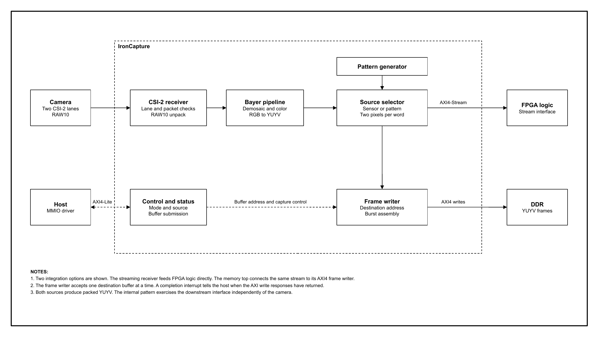

# IronCapture integration and design guide

[IronCapture Specification (PDF)](documentation/ironcapture_specification.pdf) · [Markdown](documentation/ironcapture_specification.md)

IronCapture captures a two-lane MIPI CSI-2 camera into DDR. One Vivado module
reference, `ironcapture_top`, contains the IronCapture CSI-2 receiver, Bayer processing,
YUV422 conversion, AXI4-Lite configuration and an AXI4 write master. Each
completed buffer is a packed YUYV frame in byte order Y0, Cb, Y1, Cr.
The sensor modes are 1280 × 720 and 1920 × 1080 at 30 frames per second.
The Linux capture device also provides an internal color-bar input.

This README is the Markdown design guide for engineers and AI assistants such as Claude and Codex. Start with the integration top you use, follow a frame from sensor to memory, then use the paired driver and test paths below to verify your change.



[Editable architecture slide](documentation/assets/architecture.pptx) · [Drawing source](documentation/diagrams/src/architecture.js)

| Work area | Source of truth | Interface to keep in step |
|---|---|---|
| Sensor packets and color | [Receiver architecture and registers](ip/rtlnet_csi2_rx/documentation/rtlnet_csi2_rx.md), [Bayer processor](ip/rtlnet_csi2_rx/hdl/rtlnet_csi2_rx_bayer.sv) | RAW10 lane and Bayer phase settings, black level, gains, YUYV packing and frame/line markers |
| Memory integration | [AXI top](hdl/ironcapture_top.v), [control registers](hdl/ironcapture_control.sv), [frame writer](hdl/ironcapture_writer.sv) | One descriptor, AXI data width, line and 4 KiB burst boundaries, status and completion IRQ |
| Firmware and Linux | [Portable MMIO API](driver/ironcapture.h), [driver implementation](driver/ironcapture.c), [V4L2 adapter](driver/ironcapture_linux.c) | Mode validation, buffer size, DMA addressability and teardown |
| Verification | [Writer bench](testbench/tb_ironcapture_writer.sv), [pattern-to-DDR bench](testbench/tb_ironcapture_pattern.sv), [host driver test](testbench/test_ironcapture.c) | Match bytes and geometry as well as the number of completed transfers |

## Source and integration

IronCapture owns the CSI-2 RTL, freestanding register driver, models, benches
and documentation in `ip/rtlnet_csi2_rx/`. Both hardware tops use that receiver.

| Top | Interface and use |
| --- | --- |
| `rtlnet_csi2_rx` | AXI4-Lite control and a backpressured AXI4-Stream YUYV output, with frame and line markers. The RTLNet bare-metal demo connects this top to its capture DMA and frame manager. Its register driver is under `ip/rtlnet_csi2_rx/driver/`. |
| `ironcapture_top` | AXI4-Lite control and an AXI4 memory write master. This top submits frames directly to DDR, exposes the receiver at offset `0x1000`, and supports the freestanding and Linux drivers below. |

Source `scripts/sources.tcl` in Vivado. Call `ironcapture_add_stream_sources <RTLNet-root>`
for the streaming top or `ironcapture_add_sources <RTLNet-root>` for the memory
writer. The external input is the RTLNet common primitives under `cores/rtlnet_common/`.
`scripts/resolve-receiver.ps1` locates these primitives and verifies their
Git tree against `rtlnet-common.lock.json`. The receiver keeps its original
license in `ip/rtlnet_csi2_rx/LICENSE.md`.

Set `AXI_DATA_WIDTH` to 32, 64 or 128. Connect S_AXI and M_AXI to
`axi_clk`, set `CLOCK_HZ` to that clock's frequency, and supply a 200 MHz
`ref_clk` to the 7-series D-PHY. `reset_n` is active low. Connect the HS and
LP pins with the board's electrical constraints. The Zybo Z7-20 uses a
64-bit Zynq high-performance port, board termination, and a level-high IRQ.
Software submits a 32-bit DMA address aligned to the AXI beat. The buffer
holds exactly width × height × 2 bytes with tightly packed rows. Bursts are
at most 16 beats and stop at each line end and 4 KiB boundary.

## Driver

`driver/ironcapture.c` and `driver/ironcapture.h` contain the freestanding
register API. Linux and bare-metal applications compile this same source.
Supply ordered MMIO read/write callbacks. On bare metal, allocate a DMA-safe
buffer and handle cache ownership according to the platform. Call
`ic_probe`, `ic_configure`, optionally `ic_tune`, then `ic_start` and
`ic_submit`. Poll `ic_status` or handle the interrupt. When `IC_DONE` is
set, inspect `IC_ERROR`, acknowledge with `ic_ack`, and submit the next
buffer. A consumer must finish reading before it resubmits a buffer. A stop
discards an unused descriptor and drains any issued AXI transaction. Poll
until both `IC_BUSY` and `IC_PENDING` clear before reclaiming memory.

The Linux adapter in the same folder provides a V4L2 single-plane streaming
capture device with MMAP buffers. Input 0 selects the sensor and input 1
selects the internal pattern. The device-tree compatible is
`ironkernel,ironcapture-1.0`; its endpoint references the camera sensor on
I²C. The Pcam 5C integration uses the OV5640 driver with RAW10 support.
An application requests `V4L2_PIX_FMT_YUYV` and dequeues frames. IronVideo
can scan out a DRM framebuffer in the matching `DRM_FORMAT_YUYV` format.

The capture node accepts an optional six-cell `ironkernel,bayer-profile`
property. Supply the RAW10 black offset, red/green/blue gains (Q4.8),
RAW10 highlight threshold and processing flags in that order. Bits 0–2
enable gamma, green equalization and highlight clamp, respectively. Linux
loads the profile when the sensor binds and again before each sensor stream.
The internal pattern bypasses Bayer processing.

## Register map

Registers are 32-bit little-endian. Use full-word writes.

| Offset | Register | Meaning |
|---|---|---|
| 0x000 | ID | 0x49434150 |
| 0x004 | Version | Register interface version 1 |
| 0x008 | Beat size | Implemented AXI master width in bytes |
| 0x00c | Control | Bit 0 enables buffer submission and capture |
| 0x010 | Status | Bit 0 busy, bit 1 pending, bit 2 done, bit 3 frame or AXI error |
| 0x014 | Base | Next contiguous destination address |
| 0x018 | Submit | Write 1 to arm a buffer at the next frame start |
| 0x01c | Acknowledge | Write 1 to clear completion, error and IRQ |
| 0x020 | Mode | 0 selects 720p, 1 selects 1080p. Program while idle and disabled |
| 0x024 | Completions | Number of retired transfers, including errors |
| 0x1000–0x1fff | Receiver | CSI-2 receiver register map including packet and overflow counters |

The writer holds a single descriptor in hardware. Linux maintains the buffer
queue. Without an armed buffer the receiver stream is consumed and discarded.
Success requires the expected frame geometry and successful write responses.
The receiver's packet and Bayer-size counters provide additional sensor-side
diagnostics, including CRC errors in packets whose pixels were forwarded.

## Receiver registers and pixel diagnostics

These offsets are relative to the receiver base. On the standalone stream top the base is the start of its own AXI4-Lite window.

| Offset | Function |
|---|---|
| 0x000 / 004 / 008 | ID, version and capabilities. CAPS bit 5 identifies a camera receiver. |
| 0x010 / 014 | Video mode and source. Sources are 0 automatic, 1 camera and 2 pattern. |
| 0x018 / 01C | Pattern frame period in stream clocks and camera timeout in frame periods for automatic selection. |
| 0x020 / 024 / 028 | Source and sticky status, emitted frame starts and active mode. |
| 0x030 / 034 | Pattern selection and signed motion speed, followed by pattern frame count. |
| 0x040–050 | Receiver control, receiver status, two input tap settings, settle interval and packet filter. |
| 0x054 / 058 / 05C | Counter clear mask, last received frame line count and last line pixel count. |
| 0x060–08C | Twelve counters for corrected and uncorrectable ECC, CRC, start of transmission, sensor frames, data type, truncation, FIFO overflow, size, orphan line, length and clock loss. |
| 0x090–09C | Black offset and R/G/B white-balance gains. Unity gain is 0x100 in unsigned 4.8 format. |
| 0x0A0 / 0A4 | Bayer phase and processing enables. PROC bits 0, 1 and 2 enable gamma, green equalization and highlight clamp. |
| 0x0A8 / 0AC | Last-frame RAW maxima and programmable highlight threshold. |

For a color cast, first compare the internal pattern with a physical frame. A correct pattern verifies YUYV packing through the consumer. For the camera path, verify frame dimensions and counters, then check Bayer phase and gains against a neutral target. Gain tuning is specific to the sensor and lighting.


## Bring-up and acceptance

1. Establish ordered register access and read both IDs. The top reports `ICAP` at offset zero and the receiver reports `CSI2` at `0x1000`. Check the advertised beat size against the address alignment before arming the first buffer.
2. Start with the internal pattern. A 720p frame occupies 1,843,200 bytes. A 1080p frame occupies 4,147,200 visible bytes. Verify the first Y0/Cb/Y1/Cr group, line transitions, final line and the full completion count. Linux allocates 1,088 rows at 1080p for macroblock consumers while reporting 1,080 visible rows.
3. Select the sensor, configure the external sensor and its continuous clock, and compare receiver frame/line counts with writer completions. A good pattern and bad camera image narrow the investigation to PHY, packets, Bayer phase or gains. A writer error on both sources calls for checking the submitted DMA window, geometry and AXI write responses.
4. Under Linux, queue buffers before STREAMON, dequeue each completed buffer, and export a DMA-BUF when another device needs the pixels. Requeue the capture buffer only when the consumer has finished. On shutdown, drain DMA before returning buffers.
5. In the Zybo Linux reference, physical capture returned 120/120 frames at 720p30 and 300/300 at 1080p30 with a continuous camera clock. Concurrent 1080p60 scanout recorded zero underruns in the 1080p test with the Linux USB host disabled. Record sensor source, clock policy, simultaneous DMA users, completed frames and errors when comparing results.

## Changing the implementation

For a new sensor mode, change the receiver geometry and writer expectation together with `ic_configure`, V4L2 format enumeration, allocation and sensor controls. Check TUSER on the first accepted word of the frame and TLAST at the last accepted word of every line. A change to the AXI width must preserve the little-endian YUYV pair and partial-burst flushing at line end. Pair register edits with the C header and host test.

From this checkout, use the pinned RTLNet primitives and run the writer-width and full pattern tests. Set the Vivado path to the installed version.

```powershell
.\scripts\resolve-receiver.ps1 -RtlNet ..\RTLNet -Offline
.\testbench\run-xsim.ps1 -VivadoBin C:/AMDDesignTools/2026.1/Vivado/bin -RtlNet ..\RTLNet -Output build/xsim
```

The runner checks 32-, 64- and 128-bit packing and exact 720p/1080p payload sizes. Receiver changes additionally use the matching packet, D-PHY, CDC or Bayer benches in [the receiver test suite](ip/rtlnet_csi2_rx/testbench/). A pattern regression covers the writer and downstream data path. A physical-sensor test also exercises lane alignment, packet integrity and color processing.
