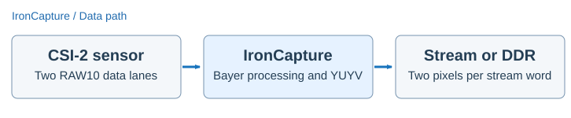

# IronCapture specification

IronCapture converts two-lane CSI-2 camera data into packed YUYV video. Its AXI4 write master captures complete frames in DDR without CPU intervention in the pixel path.

A host can give the capture engine one destination address per frame or connect the streaming receiver directly to FPGA logic. Both interfaces deliver the same two-pixel word. An internal pattern source exercises the downstream path with the sensor idle.

| Interface | Contract |
|---|---|
| Sensor | Two CSI-2 lanes carrying RAW10, with high-speed clock and low-power signalling |
| Stream | 32-bit AXI4-Stream, two YUYV pixels per accepted word |
| Memory | Write-only AXI4 master, 32-bit byte addresses, selectable 32-, 64- or 128-bit data |
| Control | 32-bit AXI4-Lite, capture completion interrupt and receiver diagnostics |
| Reference modes | 1280 × 720 and 1920 × 1080 progressive capture at 30 frames/s |
| Software | Freestanding MMIO API and Linux V4L2 single-plane capture |

## From the CSI-2 lanes to a pixel pair

The receiver aligns the two lane byte streams, checks CSI-2 packet headers, selects the programmed virtual channel and unpacks RAW10 payloads. A clock-crossing FIFO carries pixels and markers into the processing domain. The image pipeline reconstructs RGB before converting to YUYV.

| Stage | Controls and observable behavior |
|---|---|
| Physical receiver | Per-lane input delays, high-speed settle interval, lane enable and bit-order selection. The supplied AMD front end uses 7-series SelectIO and a 200 MHz delay reference. |
| Packet filter | Default virtual channel 0 and data type `0x2B` (RAW10). Corrected headers, uncorrectable headers, payload CRC and unexpected data types have separate counters. |
| Bayer reconstruction | Subtract black level and apply per-channel gains to 10-bit samples. A 3 × 3 bilinear filter reconstructs missing colors with mirrored borders. Set the phase to match the first active photosite. |
| Color processing | Optional green equalization, gamma and highlight clamp. Red, green and blue maxima are measured after black subtraction and before gain. |
| Output | On an accepted word, bits 7:0 carry Y0, 15:8 Cb, 23:16 Y1 and 31:24 Cr. The two pixels share chroma. |

The stream top `rtlnet_csi2_rx` asserts TUSER on the first word of a frame and TLAST on the final word of each active line. TVALID and TREADY qualify data transfer. Sideband signals report dimensions, source, frame number and a frame-start timestamp. The internal source provides static bars, scrolling bars, a moving box and a noise band.

The memory top `ironcapture_top` combines the receiver and writer. Its AXI interfaces share `axi_clk` and active-low reset. The Zybo reference uses a 100 MHz AXI clock, board termination and a continuous sensor high-speed clock during streaming.

## DDR writer and buffer ownership

The writer accepts one contiguous buffer descriptor. On submission it waits for a frame start, packs stream words into full-width beats and generates incrementing AXI bursts. It tracks line and frame geometry and waits for write responses before reporting the result. A frame arriving without an armed descriptor is consumed and discarded.

| Mode | Bytes per line | Bytes per captured frame | Payload at 30 frames/s |
|---|---:|---:|---:|
| 1280 × 720 | 2,560 | 1,843,200 | 55.296 MB/s |
| 1920 × 1080 | 3,840 | 4,147,200 | 124.416 MB/s |

Bandwidth figures are decimal payload rates. DDR arbitration, refresh and bus protocol overhead require additional service capacity. A 1080p input line contains 960 stream words or 480 memory beats on a 64-bit port.

**Addressing.** Align the base to the implemented beat size. The complete active frame must fit in the 32-bit DMA address space. Rows are tightly packed. Each burst is limited to 16 beats and ends at or before the next line end or 4 KiB address boundary. The master issues one write transaction at a time.

**Ownership.** Configure both mode registers while the writer is disabled and idle. Enable capture, submit the address and wait for DONE. Sample ERROR before acknowledging. Return a buffer to capture only after downstream consumers release it. On stop, wait for PENDING and BUSY to clear so an issued write can retire.

**Reading errors.** A completion with ERROR marks the buffer unusable. Receiver packet counters answer a different question: a CRC mismatch can be discovered after the affected pixels have already passed downstream. Check both DMA status and receiver counters when qualifying a camera.

## Capture control registers

Offsets are byte offsets from the memory top. Use aligned 32-bit little-endian accesses and full-word writes. The writer resets disabled in 720p mode.

| Offset | Register | Access and use |
|---|---|---|
| 0x000 | ID | Read `0x49434150` (“ICAP”). |
| 0x004 | VERSION | Read register interface version 1. |
| 0x008 | BEAT_BYTES | Read 4, 8 or 16. Use this value for address alignment. |
| 0x00C | CONTROL | Read/write bit 0 to enable. Clearing it cancels an unused descriptor. |
| 0x010 | STATUS | Read bit 0 BUSY, 1 PENDING, 2 DONE, 3 ERROR. The level-high IRQ follows completion. |
| 0x014 | BASE | Read/write the next destination byte address while available. |
| 0x018 | SUBMIT | Write bit 0 to arm BASE. A misaligned or wrapping address sets DONE and ERROR. |
| 0x01C | ACK | Write bit 0 to clear DONE, ERROR and the completion IRQ. |
| 0x020 | MODE | Read/write bit 0. Zero selects 720p, one selects 1080p. Change while idle and disabled. |
| 0x024 | FRAMES | Read the count of writer transfers that retired, including transfers that failed. |
| 0x1000–0x1FFF | Receiver | The complete receiver register window. Add the receiver offset on the next page to 0x1000. |

**Example.** On the Zybo, the capture block starts at `0x43C00000`. Reading `0x43C00008` gives 8 for the 64-bit HP2 writer. Reading `0x43C01000` returns the receiver ID `0x43534932`. These two reads distinguish the memory interface from the packet receiver.

## Receiver settings and diagnostics

These offsets are relative to the receiver base. On the standalone stream top the base is the start of its own AXI4-Lite window.

| Offset | Function |
|---|---|
| 0x000 / 004 / 008 | ID, version and capabilities. CAPS bit 5 identifies a camera receiver. |
| 0x010 / 014 | Video mode and source. Sources are 0 automatic, 1 camera and 2 pattern. |
| 0x018 / 01C | Pattern frame period in stream clocks and camera timeout in frame periods for automatic selection. |
| 0x020 / 024 / 028 | Source and sticky status, emitted frame starts and active mode. |
| 0x030 / 034 | Pattern selection and signed motion speed, followed by pattern frame count. |
| 0x040–050 | Receiver control, receiver status, two input tap settings, settle interval and packet filter. |
| 0x054 / 058 / 05C | Counter clear mask, last received frame line count and last line pixel count. |
| 0x060–08C | Twelve counters for corrected and uncorrectable ECC, CRC, start of transmission, sensor frames, data type, truncation, FIFO overflow, size, orphan line, length and clock loss. |
| 0x090–09C | Black offset and R/G/B white-balance gains. Unity gain is 0x100 in unsigned 4.8 format. |
| 0x0A0 / 0A4 | Bayer phase and processing enables. PROC bits 0, 1 and 2 enable gamma, green equalization and highlight clamp. |
| 0x0A8 / 0AC | Last-frame RAW maxima and programmable highlight threshold. |

For a color cast, first compare the internal pattern with a physical frame. A correct pattern verifies YUYV packing through the consumer. For the camera path, verify frame dimensions and counters, then check Bayer phase and gains against a neutral target. Gain tuning is specific to the sensor and lighting.

## Zybo Z7-20 reference and software

The Digilent Pcam 5C uses an OV5640 sensor. Linux configures the sensor over I²C and captures its two-lane RAW10 output through IronCapture. IronCapture uses the Zynq HP2 DDR port and GIC SPI 33. IronVideo reads a separate display buffer through HP0.

| Recorded test | Result |
|---|---|
| Physical sensor, 720p30 | 120 of 120 requested frames returned with the continuous camera clock. |
| Physical sensor, 1080p30 | 300 of 300 requested frames returned. Concurrent 1080p60 HDMI scanout recorded zero underruns. The Linux USB host was disabled for this capture test. |
| Internal pattern under encoder load | In a separate 90-second sample, capture averaged 30.0 frames/s and 124.4 MB/s at 1080p. Capture DMA errors and HDMI underruns stayed at zero. |

The Linux device exposes sensor input 0 and pattern input 1. Request single-plane YUYV MMAP buffers, queue them, start streaming and dequeue completed frames. Applications can export a buffer as a DMA-BUF for IronH264. At 1080p the active payload is 1,080 rows, while the Linux allocation accommodates 1,088 rows for a macroblock consumer.

For bare metal, probe both IDs, configure the mode and source, submit a DMA-safe buffer, then poll status or service the level interrupt. Cache maintenance and buffer reuse belong to the host platform.

## Contact IronKernel

For a camera design, include the sensor, lane configuration, capture format and frame-rate target. IronKernel can integrate the receiver, memory path and V4L2 capture into your board design.

IronKernel provides FPGA design and design review, board bring-up, bare-metal firmware, embedded Linux drivers and application development. For integration support, a reference design or a custom development proposal, send your target board and project goal.

[IronKernel.com](https://ironkernel.com/) · [support@ironkernel.com](mailto:support@ironkernel.com)

